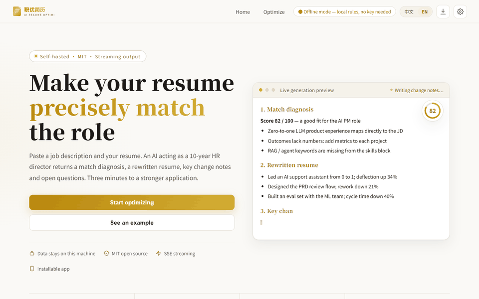
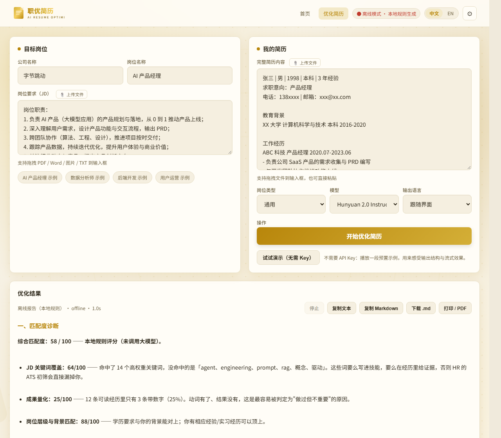

# Resume Optimizer

> Tailor a resume to a specific job description with an LLM that behaves like a hiring manager — streamed live, self-hosted, zero frameworks. The model is the endpoint you configure (Tencent Hunyuan by default); "OpenAI-compatible" here names the API shape, not OpenAI the vendor.

**English** | [中文](README.zh-CN.md)

[](https://nodejs.org)
[](https://github.com/echo33550336/Resume-optimization/actions/workflows/ci.yml)
[](https://github.com/echo33550336/Resume-optimization/pkgs/container/resume-optimization)
[](./LICENSE)
[](server.js)
[](#which-model-does-it-use)
[](#features)
[](https://echo33550336.github.io/Resume-optimization/)

<p align="center">
  
</p>

<p align="center">
  <a href="https://echo33550336.github.io/Resume-optimization/"><b>▶ Play the 5-second interactive demo</b></a>
  &nbsp;·&nbsp;
  <a href="docs/assets/screenshot-result.png">Result screenshot</a>
  &nbsp;·&nbsp;
  <a href="#quick-start">Run it locally</a>
</p>

---

## Introduction

**Resume Optimizer** turns one job description plus one resume into a match-oriented rewrite.
You paste (or upload) the JD and your resume, pick the job family, and an LLM acting as a
senior HR director returns a four-part report:

1. **Match diagnosis** — a 0–100 score with the reasons behind it.
2. **Rewritten resume** — the full resume rebuilt in STAR form, quantified, keyword-aligned with the JD, and honest (missing figures become `[add the number]` placeholders instead of invented ones).
3. **Change log** — the most important 5–8 edits and why each one matters.
4. **Gaps and risks** — information the recruiter will ask for that the resume does not answer yet.

The point is not "rewrite my bullets" — it is _diagnosis first, rewrite second_: the model must
justify the score, then show exactly which text moved the score, then flag what is still missing.
Text streams into the page as it is produced, so a 3,000-token rewrite becomes readable in seconds
instead of a spinner and a wait.

It is a single small Node.js service with a static single-page UI: no build step, no database, no
telemetry, no third-party proxy. The browser never sees the API key; the server is the only
component that talks to the LLM you configure.

## Which model does it use?

**Whatever chat endpoint you configure — Tencent Hunyuan by default. This repository ships no model
weights, no OpenAI SDK, and no OpenAI account; it calls OpenAI only if you point it there yourself.**

The word _OpenAI-compatible_ appears in this README because it is the name of a **wire format**, not
a vendor:

- `POST {LLM_API_BASE}/chat/completions` with `Authorization: Bearer <key>`
- request body `{ model, messages, temperature, max_tokens, stream }`
- non-streaming response `choices[0].message.content`; streaming response SSE `data: {...}` frames

That shape was popularised by OpenAI and is now implemented by nearly every provider, so one code
path reaches all of them. What the model actually is, is decided by `LLM_API_BASE` + `LLM_MODEL` in
`.env` — nothing in the source code is vendor-specific.

## Features

- **JD-aware rewriting** — every bullet is rewritten against the target role, STAR-style, with quantified results.
- **Streaming output (SSE)** — the result renders token by token; stop at any moment and keep what was generated.
- **Cancel and export** — stop generation, copy plain text, copy Markdown, download `.md`, or print / save as PDF.
- **Multi-format input** — paste text or drop PDF / DOCX / TXT / MD / CSV / images (OCR) onto the JD or resume box.
- **Job-family focus** — tech, product, data, ops, design, marketing, general: each carries its own optimization bias.
- **Bilingual UI (Chinese / English)** — one click switches every label; the choice is remembered in `localStorage`.
- **Report language is independent** — the model can answer in Chinese or English regardless of the interface language (`Follow interface` / `Chinese` / `English`).
- **Theme system** — brand gold / amber / dark, four fonts, four background patterns, persisted in `localStorage`.
- **Local-first and private** — nothing leaves your machine except the request to the LLM endpoint you configured.
- **Hardened server** — LLM timeout with bounded retries, typed error codes, body/upload/text limits, localhost-only CORS, static path containment, security headers, graceful shutdown.
- **Demo mode** — `POST /api/optimize` with `demo: true` (or open `/?demo=1`) replays a canned four-part report through the same SSE pipeline, so the UI can be tried with no key and no model call. A replay-only static page in [`docs/`](docs/index.html) is published to GitHub Pages.
- **Offline report** — with no `LLM_API_KEY`, or when the upstream model times out / errors, the server answers with a locally generated four-part report instead of a 503/502 page, so the tool always returns something useful. See [Offline report](#offline-report).

## Offline report

`offline.js` is a rules engine, not a model: it reads the JD and the resume, and writes the same
four-part report the LLM would (`一、匹配度诊断 / 二、优化后的简历 / 三、关键修改说明 / 四、待补充/风险提示`).

<p align="center">
  
</p>

It is used when:

1. the server starts **without** `LLM_API_KEY` — every optimize request is served offline;
2. the upstream model fails **before any text has been sent** (timeout, network error, 5xx, rate
   limit, empty answer) — the request still returns `200` with the offline report plus a `warning`;
3. the request asks for it explicitly with `"offline": true` (useful for tests and demos).

What it actually does, with no dependencies and no network:

- **Keyword coverage** — tokenises the JD (Chinese word segmentation via `Intl.Segmenter`, Latin
  tech terms kept whole, `RAG/Agent` split, `A/B` kept), weights terms that appear in requirement
  lines, and reports which ones the resume never mentions.
- **Quantified impact** — counts bullets that carry a number; unquantified bullets get an explicit
  `[请补充具体数字]` / `[add the exact number]` placeholder instead of an invented metric.
- **Verb upgrades** — 负责/参与/协助/帮助 → 主导/参与并交付/协助并推进/推动 (and the English
  equivalents), because the verb is what recruiters read as seniority.
- **Structure** — recognises education / experience / projects / skills / awards sections, keeps
  names, contacts, schools and skill lists verbatim, and rewrites only the experience bullets.
- **Scoring** — a 0–100 match score weighted 45 % keyword coverage, 30 % quantification, 25 %
  seniority/background fit, with the component scores exposed as `signals`.

The offline report is deliberately **honest about its ceiling**: it is word- and structure-level
analysis, it does not paraphrase, and the `四、待补充/风险提示` section says so. Configure an
API key when you want the full semantic rewrite.

## How it works

```
┌──────────────┐   paste / drop JD + resume    ┌──────────────────┐
│ Browser UI   │ ────────────────────────────► │ Node http server │
│ index.html   │                               │   server.js      │
└──────────────┘ ◄──── SSE: delta, delta, … ── └────────┬─────────┘
                                                        │ buildMessages()
                                                        ▼
                                               ┌──────────────────┐
                                               │   prompt.js      │
                                               │ system + user    │
                                               └────────┬─────────┘
                                                        │ POST /chat/completions
                                                        ▼
                                               ┌──────────────────┐
                                               │ chat-completions │
                                               │ endpoint         │
                                               └──────────────────┘
```

1. The UI posts `{ company, position, jd, resume, roleType, lang }`.
2. `prompt.js` assembles the system prompt (HR-director persona plus family-specific focus) and the user prompt, in the requested language.
3. `server.js` calls `POST {LLM_API_BASE}/chat/completions` — the OpenAI _wire format_, spoken by the configured provider (Hunyuan by default) — retrying only before the first delta reaches the browser.
4. Tokens are relayed as SSE frames; the UI renders Markdown incrementally and keeps the raw text for export.

## Tech stack

| Layer      | Choice                                                                                                                           |
| ---------- | -------------------------------------------------------------------------------------------------------------------------------- |
| Server     | Node.js native `http` — no framework, no router dependency                                                                       |
| Frontend   | Hand-written HTML / CSS / JS — no bundler, no build step                                                                         |
| LLM        | Any endpoint speaking the OpenAI chat-completions protocol (Tencent Hunyuan by default; OpenAI models are optional, not implied) |
| Extractors | `pdf-parse`, `mammoth`, `tesseract.js` — optional and lazily required                                                            |
| Prompts    | `prompt.js` — single source of truth, shared with the Agent Skill                                                                |
| Types      | TypeScript in `checkJs` mode over JSDoc — no transpile step                                                                      |
| Quality    | ESLint (flat config), Prettier, `node:test` unit + HTTP integration tests                                                        |
| CI / CD    | GitHub Actions: Node 18/20/22 matrix, lint/format/type/test gates, Docker build                                                  |
| Runtime    | Still zero production dependencies beyond the three extractors                                                                   |

## Project structure

```
resume-optimizer/
├── server.js                  # HTTP server: routes, SSE streaming, static files, limits
├── prompt.js                  # system / user prompt builders (single source of truth)
├── offline.js                 # rules engine: four-part report with no key and no model call
├── public/
│   ├── index.html             # single-page UI: landing, optimizer, settings, export toolbar
│   ├── i18n.js                # zh / en dictionary and DOM translation runtime
│   ├── logo.svg
│   └── bg.svg
├── test/
│   ├── prompt.test.js         # prompt builders + language normalisation
│   ├── i18n.test.js           # dictionary coverage + DOM translation runtime
│   └── server.test.js         # HTTP integration: health, SSE, extract, limits, traversal
├── .github/workflows/ci.yml   # CI: Node 18/20/22 × (check, typecheck, lint, format, test) + Docker build
├── tsconfig.json              # tsc --noEmit, checkJs over the plain JS sources
├── eslint.config.js           # flat ESLint config (Node + browser groups)
├── .prettierrc.json           # formatting rules; public/index.html stays hand-formatted
├── Dockerfile                 # node:22-alpine, production deps only, non-root, healthcheck
├── docker-compose.yml         # local container with .env passthrough
├── .nvmrc / .editorconfig / .gitattributes
├── .commandcode/
│   ├── skills/resume-optimizer/SKILL.md   # Agent Skill definition
│   └── taste/taste.md
├── .env.example
├── LICENSE
└── README.md
```

## Quick start

Prerequisites: **Node.js 18+** (needs the global `fetch`).

```bash
git clone https://github.com/echo33550336/Resume-optimization.git
cd Resume-optimization

npm install              # optional — only needed for PDF / DOCX / image extraction
cp .env.example .env     # then set LLM_API_KEY (and LLM_API_BASE if not Tencent Hunyuan)

npm start                # http://127.0.0.1:3000
npm run check            # syntax check for server.js, prompt.js and public/i18n.js
```

Without `npm install` the app still runs: text pasting works, uploads answer with a clear
"extractor not installed" message, and `GET /api/health` reports which extractors are available.

Want to look before configuring anything? Open <http://127.0.0.1:3000/?demo=1> (or click **Try a demo**
in the form) to replay a canned report with no key and no model call. The same replay, as a static
page, is the [GitHub Pages demo](https://echo33550336.github.io/Resume-optimization/).

### Minimal `.env`

The defaults already target Tencent Hunyuan, so a key is all you need in the common case. The
values below are **placeholders for the protocol** — the OpenAI block is an optional example, not
the default and not a requirement:

```dotenv
LLM_API_KEY=your-key
LLM_API_BASE=https://tokenhub.tencentmaas.com/v1                       # default (Tencent Hunyuan)
LLM_MODEL=hunyuan-2.0-instruct-20251111                               # default model
# Optional, only if you want OpenAI models:
# LLM_API_BASE=https://api.openai.com/v1
# LLM_MODEL=gpt-4o-mini
```

## Configuration

Every setting can come from `.env` or from real environment variables (real environment wins):

| Variable            | Default                               | Meaning                                                                         |
| ------------------- | ------------------------------------- | ------------------------------------------------------------------------------- |
| `LLM_API_KEY`       | —                                     | Bearer token for the endpoint (**required**)                                    |
| `LLM_API_BASE`      | `https://tokenhub.tencentmaas.com/v1` | Base URL speaking the OpenAI chat-completions protocol (a format, not a vendor) |
| `LLM_MODEL`         | `hunyuan-2.0-instruct-20251111`       | Default model                                                                   |
| `LLM_MAX_TOKENS`    | `4096`                                | Max output tokens                                                               |
| `LLM_TIMEOUT_MS`    | `120000`                              | Per-attempt timeout (minimum 5000)                                              |
| `LLM_RETRIES`       | `2`                                   | Retries on 429 / 5xx / network failure, before any token is streamed            |
| `PORT`              | `3000`                                | Listen port                                                                     |
| `HOST`              | `127.0.0.1`                           | Listen host — keep loopback unless you know why                                 |
| `MAX_BODY_BYTES`    | `20971520` (20 MB)                    | Max JSON request body                                                           |
| `MAX_EXTRACT_BYTES` | `20971520` (20 MB)                    | Max uploaded file size                                                          |
| `MAX_TEXT_CHARS`    | `60000`                               | Max characters for JD / resume / extracted text                                 |
| `ALLOWED_ORIGINS`   | —                                     | Extra CORS origins, comma separated (localhost is always allowed)               |

## Usage

1. Open `http://127.0.0.1:3000` and click **Optimize resume**.
2. Fill in company and position, paste the JD and your resume — or drag a file onto either box.
3. Pick a job family (it changes what the model emphasises), a model, and the **report language**
   (`Follow interface` keeps it in sync with the Chinese / EN switch).
4. Press **Optimize**. The report streams in; **Stop** cancels, the toolbar offers copy as text, copy as Markdown, download `.md`, and print.
5. Prefer a different light? **Settings** switches theme, font, and background; choices persist locally.

Keyboard: `Ctrl/Cmd + Enter` submits, `Esc` closes the settings dialog.

### Internationalization

The `ZH / EN` switch in the header translates the whole interface (landing page, forms, result
toolbar, settings, toasts, error messages). The **Report language** dropdown next to the model picker
is independent: `Follow interface`, `Chinese` or `English`, and it is what `lang`/`outputLang` carry
to the server — so an English-speaking user can ask for a Chinese resume report, and vice versa.

- Dictionaries: `public/i18n.js` (`EN`, `ZH`, one key per string, `{name}` interpolation).
- Markup carries `data-i18n`, `data-i18n-placeholder`, `data-i18n-title`, `data-i18n-aria-label`, `data-i18n-alt`.
- Runtime API: `window.RI18N.t(key, vars)`, `.setLang('zh' | 'en')`, `.apply(lang)`, `.lang`; emits a `ri18n:change` event.
- The choice is persisted under `resume-optimizer-lang`; first visit falls back to `navigator.language`.

## API

All JSON endpoints answer `{ "ok": true, ... }` on success and `{ "ok": false, "code": "...", "error": "..." }` on failure.

### `GET /api/health`

```json
{
  "ok": true,
  "model": "hunyuan-2.0-instruct-20251111",
  "hasKey": true,
  "offline": true,
  "mode": "llm",
  "streaming": true,
  "roleTypes": ["general", "tech", "product", "data", "ops", "design", "marketing"],
  "langs": ["zh", "en"],
  "outputLangs": ["auto", "zh", "en"],
  "extractors": { "pdf": true, "docx": true, "ocr": true },
  "limits": {
    "maxBodyBytes": 20971520,
    "maxExtractBytes": 20971520,
    "maxTextChars": 60000,
    "llmTimeoutMs": 120000
  }
}
```

### `POST /api/extract`

```json
{ "filename": "resume.pdf", "data": "<base64 or data URL>" }
```

Response: `{ "ok": true, "text": "...", "meta": { "filename": "resume.pdf", "ext": "pdf", "bytes": 81234, "chars": 4210, "elapsedMs": 640 } }`

### `POST /api/optimize`

```json
{
  "company": "Acme Corp",
  "position": "Senior Backend Engineer",
  "jd": "We are looking for ...",
  "resume": "Experience: ...",
  "roleType": "tech",
  "lang": "en",
  "outputLang": "zh",
  "model": "hunyuan-2.0-instruct-20251111",
  "stream": true,
  "offline": false
}
```

- `lang` (optional) — `zh` or `en`: the **interface** language the request comes from. Defaults to `zh`.
- `outputLang` (optional) — `auto` | `zh` | `en`: the language the **report** is written in.
  `auto` (default) follows `lang`. Both `lang` and `outputLang` are echoed back (`lang` = report
  language actually used, `uiLang` = interface language), and in SSE the `meta` frame carries both.
- `offline` (optional) — `true` forces the local rules engine even when a key is configured.
  Without a key the offline report is served anyway, so this is mostly for tests and demos.

- `stream: false` (default) — returns `{ "ok": true, "content": "...", "model": "...", "lang": "zh", "uiLang": "en", "usage": { ... }, "elapsedMs": 8421 }`.
  Offline answers additionally carry `"offline": true`, `"model": "offline"`, `"signals": { ... }`,
  and `"fallback": true` + `"warning": { "code": "...", "error": "..." }` when the model failed first.
- `stream: true` or `Accept: text/event-stream` — returns `text/event-stream`:

```
event: meta
data: {"model":"hunyuan-2.0-instruct-20251111","offline":false,"roleType":"tech","lang":"zh","uiLang":"en","startedAt":"2026-01-01T00:00:00.000Z"}

event: delta
data: {"content":"## 1. Match diagnosis\n"}

event: delta
data: {"content":"- Score: 78/100 ..."}

event: done
data: {"model":"hunyuan-2.0-instruct-20251111","offline":false,"usage":{"total_tokens":3120},"chars":4210,"elapsedMs":8421}
```

When the model fails before the first delta, the stream stays open: an `event: fallback` frame
(`{"code":"UPSTREAM_TIMEOUT","error":"..."}`) arrives, followed by the offline report in the usual
`delta` frames and a `done` frame with `"offline": true`.

A comment frame `: ping` is sent every 15 seconds to keep idle connections alive. Failures after the
stream has started arrive as `event: error` frames; failures before it arrive as plain JSON.

### Error codes

| HTTP | `code`                                                                                                  | When                                                              |
| ---- | ------------------------------------------------------------------------------------------------------- | ----------------------------------------------------------------- |
| 400  | `INVALID_JSON`                                                                                          | Body is not valid JSON                                            |
| 400  | `INVALID_REQUEST`                                                                                       | Missing / empty required field                                    |
| 400  | `TEXT_TOO_LONG`                                                                                         | Text exceeds `MAX_TEXT_CHARS`                                     |
| 400  | `INVALID_BASE64`                                                                                        | Upload payload is not valid base64                                |
| 404  | `NOT_FOUND`                                                                                             | Unknown API route                                                 |
| 405  | `METHOD_NOT_ALLOWED`                                                                                    | Wrong HTTP verb for the route                                     |
| 413  | `BODY_TOO_LARGE`                                                                                        | Request body over `MAX_BODY_BYTES`                                |
| 413  | `FILE_TOO_LARGE`                                                                                        | Upload over `MAX_EXTRACT_BYTES`                                   |
| 415  | `UNSUPPORTED_TYPE`                                                                                      | File extension not supported                                      |
| 422  | `EXTRACT_EMPTY`                                                                                         | Extraction produced no text                                       |
| 429  | `UPSTREAM_RATE_LIMITED`                                                                                 | LLM endpoint rate-limited the request                             |
| 502  | `UPSTREAM_NETWORK` / `UPSTREAM_ERROR` / `UPSTREAM_EMPTY` / `UPSTREAM_INVALID` / `UPSTREAM_STREAM_ERROR` | Upstream transport, status, empty or malformed answer             |
| 503  | `NO_API_KEY`                                                                                            | Server has no `LLM_API_KEY` (served as an offline report instead) |
| 503  | `EXTRACTOR_UNAVAILABLE`                                                                                 | PDF / DOCX / OCR dependency not installed                         |
| 504  | `UPSTREAM_TIMEOUT`                                                                                      | No answer within `LLM_TIMEOUT_MS`                                 |
| 499  | `CLIENT_CLOSED`                                                                                         | Browser disconnected (server-side only, not sent to the client)   |

## Security model

- **CORS**: only same-origin, `localhost`, `127.0.0.1`, `[::1]`, and `ALLOWED_ORIGINS` are allowed — a random page cannot drive your local server with your API key.
- **Static files**: served only from `public/`, with a `path.relative` containment check and dot-file blocking.
- **Key handling**: the API key stays on the server; logs run through `sanitize()` before printing, so tokens are masked as `***`.
- **Limits**: request bodies, uploads, and prompt text are all bounded; 413 responses close the connection so oversized clients fail fast.
- **Exposure**: bind to `127.0.0.1` (the default). If you deploy it behind a reverse proxy, add authentication yourself — this project has none.

## Deployment notes

- The service is stateless; one process per port is enough.
- For a container or an internal server, set `HOST=0.0.0.0`, keep `ALLOWED_ORIGINS` tight, and terminate TLS at a proxy.
- Optional extractors pull native/heavy dependencies (`tesseract.js` downloads language data on first OCR). Install them only if you need file uploads.

### Docker

Pull the prebuilt image from GHCR (published on every `v*` tag by
[`docker-publish.yml`](./.github/workflows/docker-publish.yml)):

```bash
cp .env.example .env      # then fill LLM_API_KEY / LLM_API_BASE / LLM_MODEL
docker run --rm -p 127.0.0.1:3000:3000 --env-file .env \
  ghcr.io/echo33550336/resume-optimization:latest
```

Or build it yourself with Compose:

```bash
cp .env.example .env      # then fill LLM_API_KEY / LLM_API_BASE / LLM_MODEL
docker compose up -d --build
```

Or without Compose:

```bash
docker build -t resume-optimizer .
docker run --rm -p 127.0.0.1:3000:3000 --env-file .env resume-optimizer
```

The image installs production dependencies only, runs as the unprivileged `node` user, and ships a
`HEALTHCHECK` that polls `/api/health`, so orchestration platforms can restart it on failure.

### Static demo page (GitHub Pages)

`docs/` is a standalone, server-less replay of the product page and a demo run: `docs/index.html`
reads `docs/assets/demo-report.json` and types out the same four-part report with a 5-second
streaming animation, plus the recorded GIF and screenshots. It is published with
**Settings → Pages → Deploy from a branch → `main` / `/docs`** and is reachable at
<https://echo33550336.github.io/Resume-optimization/>. Nothing secret lives there; the replay never
calls a model.

Regenerate the media after UI changes:

```bash
node server.js                                        # terminal 1 (demo mode needs no key)
node scripts/capture.js --base http://127.0.0.1:3000  # screenshots + docs/assets/frames
python scripts/build-media.py                         # demo.gif, social-preview.png, demo-report.json
```

## Agent Skill

`.commandcode/skills/resume-optimizer/SKILL.md` lets an Agent CLI run the same workflow without the
web UI: it documents the input contract, the system prompt, and the expected output shape. The
canonical prompt lives in `prompt.js`; when you change one, update the other so they do not drift.

## Development

```bash
npm install        # runtime + dev dependencies (dev only needed for the quality gates)
npm start          # run locally on http://127.0.0.1:3000
```

Quality gates — the same commands CI runs:

| Command                 | What it does                                                                                 |
| ----------------------- | -------------------------------------------------------------------------------------------- |
| `npm run check`         | `node --check` on `server.js`, `prompt.js`, `demo-report.js`, `offline.js`, `public/i18n.js` |
| `npm run typecheck`     | `tsc --noEmit` with `allowJs`/`checkJs` — types come from JSDoc comments                     |
| `npm run lint`          | ESLint flat config: Node rules for the server/tests, browser rules for JS                    |
| `npm run format:check`  | Prettier verification (`npm run format` rewrites in place)                                   |
| `npm test`              | `node:test` unit tests + an HTTP integration test against a mock LLM                         |
| `npm run test:coverage` | Same suite with Node's experimental coverage reporter                                        |
| `npm run ci`            | All of the above in one shot                                                                 |

The integration test spawns the real server on a free port in `3400-3459`, points it at a local mock
of `/chat/completions`, and asserts health, 404/405 routing, report-language wiring, SSE frames,
text extraction and path-traversal rejection. It needs no API key and no network.

The offline suite (`test/offline.test.js`) covers the rules engine on its own: four-part headings in
both languages, deterministic output, keyword matching, placeholders only on unquantified experience
lines, verb upgrades, and the no-CJK rule for English reports. The integration suite also boots the
server with no key (offline mode) and with a dead upstream (fallback mode) to prove that neither
returns an error page.

The frontend has no build step: edit `public/index.html`, refresh the page. The server sends
`Cache-Control: no-store` for HTML, so changes appear immediately.

## Roadmap

- [x] Offline report when there is no key or the model fails
- [ ] Session history with saved comparisons
- [ ] Multi-turn refinement of a single section
- [ ] DOCX export with real formatting
- [ ] Streaming token / latency metrics in the UI
- [ ] Pluggable prompt profiles for different industries

## License

[MIT](./LICENSE) © echo33550336
